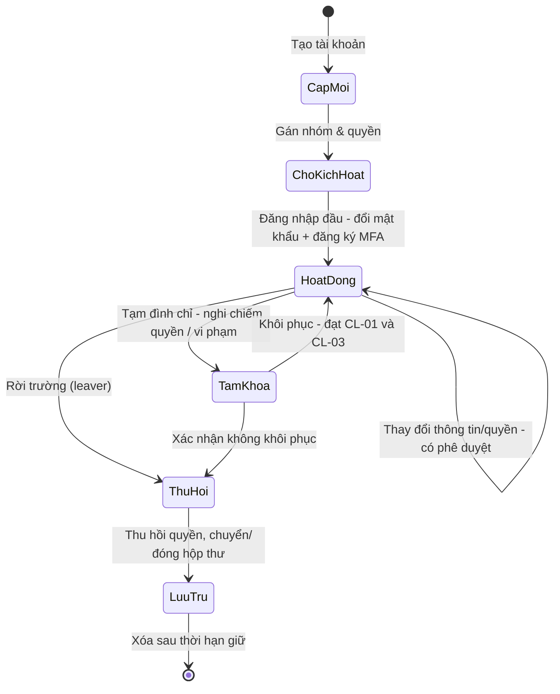
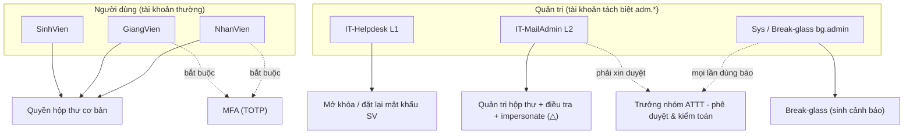

# Chương 3 — Chính sách an toàn tài khoản & quản trị danh tính (IAM)

*Phụ trách: Đỗ Quốc Huynh — hàm Govern / Identify / Protect theo NIST SP 800-61r3 (CSF 2.0).*

Chương này trình bày **chính sách** mà trường áp dụng để bảo vệ tài khoản email, và cách
**cấu hình kỹ thuật** trên hệ thống định danh (Keycloak) để *cưỡng chế* chính sách đó. Mỗi
điều khoản chính sách đều gắn với một hoặc nhiều ca kiểm thử cấu hình (TC-01…TC-17) ở Chương 6,
nhằm trả lời câu hỏi **Q1 — chính sách có thực sự cưỡng chế được bằng kỹ thuật hay không**.

## 3.1 Mô hình quản trị (Govern)

### 3.1.1 Vai trò và trách nhiệm
| Vai trò | Ký hiệu | Trách nhiệm chính với tài khoản email |
|---|---|---|
| Sinh viên | SV | Người dùng cuối; chịu chính sách yếu nhất ở v0 (thường không MFA). |
| Giảng viên | GV | Người dùng cuối giá trị cao; bắt buộc MFA (TOTP). |
| Nhân viên | NV | Như GV. |
| Helpdesk (IT L1) | Helpdesk | Mở khóa SV, hỗ trợ quên mật khẩu mức 1–2; **không** được đặt lại MFA của GV. |
| Mail Admin (IT L2) | Mail Admin | Quản trị hộp thư, điều tra, kiểm soát sự cố ở lớp mail. |
| Sys Admin / Break-glass | bg.admin | Tài khoản khẩn cấp; mọi lần dùng phải sinh cảnh báo. |
| Trưởng nhóm ATTT | — | Phê duyệt phân mức P1/P2, xử lý xung đột lợi ích (vd mạo danh admin). |

Nguyên tắc: **tách tài khoản quản trị** khỏi tài khoản thường (`adm.<ten>` riêng — TC-07),
và **đặc quyền tối thiểu** — helpdesk chỉ làm được đúng phần của mình (TC-08).

### 3.1.2 Phân loại tài khoản và trạng thái
Tài khoản có các trạng thái vòng đời: *đang hoạt động → tạm đình chỉ (nhận thư nhưng không
đăng nhập được) → rời trường (leaver)*. Trạng thái "tạm đình chỉ" (TC-13) rất quan trọng cho
ứng phó sự cố: khi nghi ngờ bị chiếm quyền, ta khóa đăng nhập nhưng **vẫn nhận thư** để không
mất mail hợp lệ và không lộ cho kẻ tấn công biết đã bị phát hiện.

### 3.1.3 Căn cứ pháp lý (liên kết Chương 2 & phần pháp lý)
Chính sách bám theo nghĩa vụ của Luật An ninh mạng 2018 và Nghị định 13/2023/NĐ-CP về bảo vệ
dữ liệu cá nhân: email trường chứa DLCN (họ tên, MSSV, liên lạc) nên sự cố chiếm quyền có thể
là *vi phạm dữ liệu cá nhân*, kéo theo nghĩa vụ thông báo (xem Chương 4 §quy trình pháp lý).

### 3.1.4 Bảng phân quyền (ma trận vai trò × quyền)

Bảng dưới áp dụng cho cấu hình **v1**. Ký hiệu: ✔ được phép · ✖ không · △ có điều kiện
(phải có phê duyệt và/hoặc ghi log). Các tài khoản quản trị là tài khoản **tách biệt** `adm.*`.

| Năng lực / Quyền | SV | GV/NV | Helpdesk (L1) | Mail Admin (L2) | Sys / Break-glass |
|---|:--:|:--:|:--:|:--:|:--:|
| Đăng nhập webmail | ✔ | ✔ | ✔ | ✔ | ✔ |
| Gửi/nhận thư nội bộ | ✔ | ✔ | ✔ | ✔ | ✔ |
| Gửi thư ra ngoài miền | ✖ | ✔ | ✔ | ✔ | ✔ |
| Gửi tới danh sách all-staff/all-student | ✖ | △ | ✖ | △ | △ |
| Dùng IMAP/SMTP (app password) | ✖ | ✔ | ✔ | ✔ | ✔ |
| Tự đổi mật khẩu / MFA của chính mình | ✔ | ✔ | ✔ | ✔ | ✔ |
| Mở khóa / đặt lại mật khẩu cho **SV** | ✖ | ✖ | ✔ | ✔ | ✔ |
| Đặt lại mật khẩu cho **GV/NV** | ✖ | ✖ | ✖ | ✔ | ✔ |
| Gỡ / đặt lại **MFA** của người khác | ✖ | ✖ | ✖ | △ | ✔ |
| Đọc log hệ thống / SIEM | ✖ | ✖ | △ | ✔ | ✔ |
| Quản trị realm / cấu hình hệ thống | ✖ | ✖ | ✖ | △ | ✔ |
| Đăng nhập thay người dùng (impersonate) | ✖ | ✖ | ✖ | △ | ✔ |
| Dùng tài khoản break-glass | ✖ | ✖ | ✖ | ✖ | ✔ |

> Nguyên tắc **đặc quyền tối thiểu** và **tách nhiệm vụ**: helpdesk mở khóa được SV nhưng không
> đụng tới MFA của GV (TC-08); mọi hành động △ của Mail Admin (impersonate, gỡ MFA) đều phải có
> phê duyệt của **Trưởng nhóm ATTT** và được ghi log để kiểm toán (chống lạm quyền — D2b).

### 3.1.5 Vòng đời tài khoản

Tài khoản đi qua các trạng thái sau; trạng thái **Tạm khóa** là bản lề cho ứng phó sự cố (khóa
đăng nhập nhưng vẫn nhận thư — TC-13):

| Giai đoạn | Hành động chính | Điều khiển |
|---|---|---|
| Cấp mới | Tạo tài khoản, sinh mật khẩu tạm | duyệt của đơn vị |
| Kích hoạt | Lần đăng nhập đầu: ép đổi mật khẩu + đăng ký MFA | P-06, TC-01 |
| Thay đổi | Đổi nhóm/quyền/thông tin | ghi admin events, có phê duyệt |
| Tạm khóa | Đình chỉ đăng nhập, **vẫn nhận thư** | TC-13, dùng khi nghi sự cố |
| Thu hồi | Người rời trường: gỡ quyền, chuyển/đóng hộp thư | TC-14 (leaver) |

### 3.1.6 Kiểm tra quyền định kỳ (periodic access review)

Mục đích: phát hiện **quyền thừa**, tài khoản bỏ quên và tài khoản đặc quyền không còn cần thiết —
giảm bề mặt tấn công trước khi sự cố xảy ra.

| Hạng mục rà soát | Tần suất | Người chịu trách nhiệm |
|---|---|---|
| Tài khoản không đăng nhập > 90 ngày | mỗi học kỳ | Mail Admin |
| Quyền thực tế so với vai trò (phát hiện quyền thừa) | 6 tháng | Chủ quản đơn vị + Mail Admin |
| Tái chứng nhận tài khoản đặc quyền (admin recertification) | 3 tháng | Trưởng nhóm ATTT |
| Tài khoản người rời trường chưa thu hồi | mỗi học kỳ | Helpdesk + Nhân sự |
| Quy tắc chuyển tiếp / ủy quyền hộp thư bất thường | 6 tháng | Mail Admin |

Quy trình: xuất danh sách → chủ quản xác nhận "giữ/thu hồi" → thực hiện thu hồi quyền thừa →
ghi biên bản rà soát. Kết quả rà soát là đầu vào để điều chỉnh bảng phân quyền §3.1.4.

### 3.1.7 Sơ đồ phân quyền (RBAC)

## 3.2 Chính sách mật khẩu (Protect) — theo NIST SP 800-63B-4

NIST SP 800-63B-4 đã **thay đổi căn bản** so với quan niệm cũ. Chính sách của nhóm theo chuẩn mới:

| # | Điều khoản chính sách | Căn cứ 800-63B-4 | Cưỡng chế bằng | TC |
|---|---|---|---|---|
| P-01 | Độ dài tối thiểu **12 ký tự**, cho phép tới ≥64, chấp nhận mọi ký tự in được + khoảng trắng | §3.1.1.1 ưu tiên độ dài | Keycloak password policy `length(12)` | TC-02 |
| P-02 | **Không** bắt buộc quy tắc phức tạp (hoa/thường/ký tự đặc biệt) | 800-63B bỏ yêu cầu thành phần | không bật `upperCase/specialChars` | TC-02 |
| P-03 | **Không** bắt xoay vòng mật khẩu định kỳ; chỉ đổi khi có dấu hiệu lộ | 800-63B bỏ hạn dùng định kỳ | không đặt `forceExpiredPasswordChange` định kỳ | — |
| P-04 | Chặn **danh sách mật khẩu phổ biến/đã lộ** (blocklist) | §3.1.1.2 so khớp danh sách lộ | Keycloak policy `passwordBlacklist` + tệp denylist | TC-03 |
| P-05 | Cấm tái dùng **5 mật khẩu** gần nhất | lịch sử để chống tái lộ | `passwordHistory(5)` | TC-04 |
| P-06 | Đổi mật khẩu + đăng ký MFA **ngay lần đăng nhập đầu** | khởi tạo an toàn | required action `UPDATE_PASSWORD` + `CONFIGURE_TOTP` | TC-01 |

> **Lưu ý triển khai (đã ghi nhận trong skill `keycloak-iam-lab`):** tính năng blocklist dựa trên
> danh sách tệp cần đặt tệp denylist đúng chỗ Keycloak đọc được; phải kiểm thử trên lab, không
> suy đoán. Đánh dấu cần verify trong Chương 6.

## 3.3 Chính sách xác thực đa yếu tố (MFA) — theo AAL của 800-63B-4

| # | Điều khoản | Vai trò áp dụng | Loại MFA | Cưỡng chế | TC |
|---|---|---|---|---|---|
| M-01 | Bắt buộc MFA cho mọi tài khoản **GV/NV/IT** | GV, NV, Helpdesk, Mail Admin | TOTP tối thiểu | Keycloak conditional flow theo nhóm | TC-06 |
| M-02 | IT dùng MFA **chống phishing** (WebAuthn/khóa cứng) khi khả thi | Helpdesk, Mail Admin, Sys | WebAuthn | browser flow + WebAuthn policy | TC-06 |
| M-03 | SV: v0 **không** MFA (mô phỏng thực tế), v1 **khuyến nghị/bắt buộc** TOTP | SV | TOTP | khác biệt v0↔v1 | TC-06 |
| M-04 | Mã khôi phục (recovery codes) cấp khi đăng ký MFA | tất cả có MFA | — | recovery codes | — |

**Ba cạm bẫy MFA phải nêu trong báo cáo (rất dễ bị hội đồng hỏi):**

1. **Direct Grant bỏ qua MFA.** Luồng cấp token trực tiếp (Resource Owner Password Credentials)
   của Keycloak **không chạy browser flow**, nên với tài khoản chưa có OTP nó bỏ qua quy tắc MFA.
   → Chính sách v1 phải **tắt Direct Grant** cho client người dùng, hoặc chặn ở tầng mạng. (Liên quan
   trực tiếp đến điểm rải mật khẩu — xem §pitfall 3/4 của skill và Chương 6 D2a.)
2. **Giao thức "legacy" vượt MFA, hiểu cho đúng.** Ở chế độ IdP, IMAP/SMTP **chỉ** nhận *app password*,
   nên chính app password là "token không-MFA" mà kẻ tấn công dùng để bám trụ. Ở chế độ native, hộp
   thư **chưa bật TFA** sẽ nhận mật khẩu thường trên IMAP/SMTP — đây đúng là lỗ hổng v0. Chính sách v1:
   SV **không** được dùng IMAP/SMTP bằng mật khẩu (TC-11).
3. **Kẻ tấn công tự đăng ký MFA.** Với tài khoản chưa có OTP, hành động `CONFIGURE_TOTP` mặc định bật,
   nên **kẻ tấn công** có thể tự gắn TOTP của *chúng* → khóa luôn chủ tài khoản. Đây vừa là điểm bám
   trụ (persistence) vừa là lý do chính sách bắt đăng ký MFA ngay lần đầu (P-06/M-01) để "chiếm chỗ"
   trước kẻ tấn công.

## 3.4 Chính sách chống dò quét & giới hạn tần suất (Protect/Detect)

| # | Điều khoản | Cưỡng chế | TC |
|---|---|---|---|
| B-01 | Khóa tạm thời **tăng dần** sau 10 lần sai (không khóa vĩnh viễn) | Keycloak brute-force detection, temporary lockout | TC-05 |
| B-02 | Giới hạn gửi thư **30 thư/giờ** cho SV (chống lạm dụng gửi spam) | mailcow ratelimit | TC-12 |
| B-03 | SV **không** được gửi tới nhóm all-staff/all-student | phân quyền danh sách phân phối | TC-09 |
| B-04 | SV (v1) **không** chuyển tiếp ra ngoài trường | chặn forwarding/Sieve ngoài miền | TC-10 |

> **Khóa có thể bị vũ khí hóa (pitfall 5):** nếu khóa vĩnh viễn, kẻ tấn công cố tình nhập sai để
> khóa người dùng hợp lệ → tấn công từ chối dịch vụ (D2c). Do đó B-01 dùng khóa **tạm thời, tăng dần**.

## 3.5 Chính sách khôi phục tài khoản (liên quan quy trình Chương 4)

- **R-01.** Email/SĐT khôi phục phải là **địa chỉ cá nhân đã xác minh**, *không* phải chính hộp thư
  trường — nếu không, luồng "quên mật khẩu" gửi link về đúng hộp thư đang bị khóa/chiếm (pitfall 6).
  Trong Keycloak, thuộc tính `email` của người dùng chính là đích của luồng quên mật khẩu, nên phải
  trỏ tới `external.lab` đã xác minh hoặc dùng recovery codes.
- **R-02.** Xác minh danh tính theo 3 mức (CL-01) trước khi cấp lại — chi tiết ở Chương 4.
- **R-03.** Quy trình người rời trường (leaver): thu hồi quyền, chuyển/đóng hộp thư (TC-14).

## 3.6 Chính sách nhật ký & bằng chứng (Govern/Detect)

Để trả lời **Q3** (phát hiện bằng log nào) và **Q6** (bằng chứng đủ dựng lại timeline), chính sách
bắt buộc các trường log tối thiểu và chống giả mạo/mất log:

- **L-01.** Mọi sự kiện định danh ghi đủ trường: thời gian (UTC), loại sự kiện, tài khoản, **IP nguồn**,
  user-agent, kết quả (TC-16). Keycloak phải bật ghi sự kiện LOGIN/LOGIN_ERROR/UPDATE_CREDENTIAL/
  IMPERSONATE và **ghi cả sự kiện thành công ở mức info** (mặc định jboss-logging log success ở DEBUG
  → cần `--spi-events-listener--jboss-logging--success-level=info`; đã ghi trong skill).
- **L-02.** Log được đẩy sang SIEM (Wazuh); **xóa log cục bộ vẫn còn bản ở SIEM** (TC-17) — chống kẻ
  tấn công/nội gián xóa dấu vết.
- **L-03.** Đồng bộ thời gian (NTP) toàn hệ thống để mốc T0–T6 khớp nhau giữa các nguồn log.

## 3.7 Hai cấu hình đối chứng v0 và v1

Đây là **xương sống thực nghiệm** của đồ án: v0 là hiện trạng phổ biến (yếu), v1 là sau khi áp
chính sách chương này. Chương 7 so sánh kết quả tấn công/phát hiện giữa hai cấu hình.

| Hạng mục | v0 (mặc định, yếu) | v1 (đã áp chính sách) | Điều khoản |
|---|---|---|---|
| MFA cho SV | Không | Bật/khuyến nghị TOTP | M-03 |
| Chính sách mật khẩu | Lỏng, không blocklist | ≥12 ký tự + blocklist + history | P-01,04,05 |
| Lần đăng nhập đầu | Không ép đổi/MFA | Ép đổi mật khẩu + đăng ký MFA | P-06 |
| Direct Grant | Bật | Tắt cho client người dùng | M-cạm bẫy 1 |
| IMAP/SMTP cho SV | Mật khẩu thường | Không (chỉ app password có kiểm soát) | M-cạm bẫy 2, TC-11 |
| Chuyển tiếp ra ngoài | Cho phép | Chặn với SV | B-04, TC-10 |
| Khóa brute-force | Lỏng/không | Tạm thời, tăng dần sau 10 lần | B-01, TC-05 |
| Giới hạn gửi | Lỏng | 30 thư/giờ (SV) | B-02, TC-12 |
| Ghi log success | DEBUG (ẩn) | info (hiện) + đẩy SIEM | L-01, L-02 |

## 3.8 Truy vết chính sách → kiểm thử (traceability)

Mỗi điều khoản ở trên đều có ca kiểm thử tương ứng trong **Chương 6 §6.5 (TC-01…TC-17)**, ghi theo
mẫu: *điều khoản chính sách | các bước | kết quả mong đợi | kết quả thực tế | ảnh chụp*. Đây là bằng
chứng trực tiếp cho câu hỏi **Q1**. Những điều khoản mà hành vi công cụ còn **chưa kiểm chứng** (đánh
dấu trong các skill) sẽ được xác nhận thực nghiệm trước khi khẳng định trong báo cáo.
