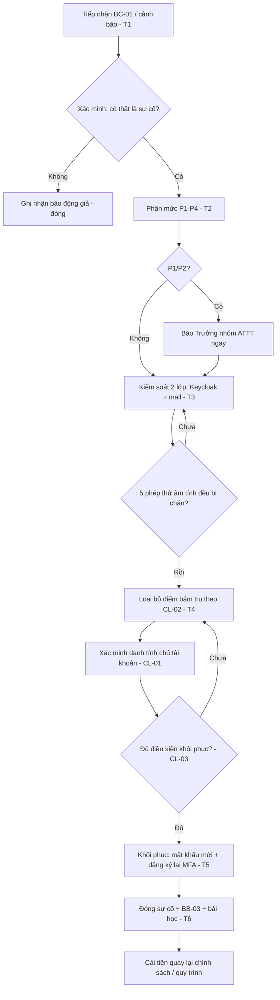

# Chương 4 — Quy trình phản ứng sự cố chiếm quyền tài khoản email

*Phụ trách: Nguyễn Bá Khánh — hàm Detect / Respond / Recover theo NIST SP 800-61r3.*

Chương này mô tả **quy trình vận hành** từ lúc phát hiện dấu hiệu bất thường đến lúc đóng sự cố,
kèm bộ biểu mẫu chuẩn hóa (BC-01…CL-03 trong `../lab/forms/`). Quy trình được thiết kế riêng cho
đặc thù *chiếm quyền tài khoản email* — nơi **một hành động khóa ở một lớp không đủ**, vì hệ thống
có **hai kho định danh** (Keycloak và mailcow) và kẻ tấn công có nhiều điểm bám trụ.

## 4.1 Vòng đời ứng phó (ánh xạ NIST SP 800-61r3)

```
Phát hiện → Tiếp nhận & Phân mức → Kiểm soát (Containment) → Loại bỏ (Eradication)
          → Khôi phục (Recovery) → Đóng & Bài học (Post-incident)
   T1            T2                    T3                        T4            T5        T6
```
- **Detect (T1):** cảnh báo SIEM hoặc người dùng báo (BC-01).
- **Respond (T2–T4):** phân mức, kiểm soát hai lớp, loại bỏ điểm bám trụ.
- **Recover (T5):** trả tài khoản cho chủ hợp lệ theo điều kiện CL-03.
- **Post (T6):** đóng sự cố, hotwash, cải tiến (đưa về Chương 3/4).

### 4.1.1 Lưu đồ quy trình xử lý sự cố



Lưu đồ bám sát vòng đời §4.1; các mốc T1–T6 trên lưu đồ là nguồn tính chỉ số ở §4.7. Hai điểm
quay lui (loop) thể hiện nguyên tắc **không tiến bước nếu chưa đạt**: chưa chặn đủ 5 phép thử thì
còn kiểm soát tiếp; chưa đạt điều kiện CL-03 thì còn loại bỏ/điều tra tiếp, không vội khôi phục.

## 4.2 Phát hiện (Detect)

Nguồn phát hiện và use case tương ứng (chi tiết luật ở Chương 5/`wazuh-email-detection`):

| Nguồn | Dấu hiệu | Use case |
|---|---|---|
| Wazuh ← Keycloak | nhiều LOGIN_ERROR nhiều tài khoản từ 1 IP | UC1 brute force / UC2 spraying |
| Wazuh ← Keycloak | đăng nhập thành công từ IP lạ/ngoài giờ | UC3 off-campus login |
| Wazuh ← Keycloak | Direct Grant login | UC4 |
| Wazuh ← Keycloak | tự đăng ký TOTP (CONFIGURE_TOTP) | UC5 MFA self-enrol |
| Wazuh ← Keycloak | IMPERSONATE | UC6 mạo danh admin |
| Wazuh ← Keycloak | đăng nhập break-glass | UC7 |
| Wazuh ← mailcow | burst lỗi đăng nhập Dovecot | UC8 |
| Người dùng | "tôi không gửi những thư này", quên mật khẩu bất thường | BC-01 |

**Chỉ số phát hiện:** MTTD = T1 − T0. Trong diễn tập T0 đã biết (vì là kịch bản) nên còn dùng để
kiểm **Q6**: chỉ từ log có dựng lại được T0 không (pitfall 18).

## 4.3 Tiếp nhận & phân mức (Triage)

Người trực tiếp nhận BC-01 (báo cáo sự cố), ghi **T1**, rồi phân mức:

| Mức | Tiêu chí | Ví dụ |
|---|---|---|
| **P1** | Tài khoản IT/quản trị, hoặc lan nhiều tài khoản, hoặc nghi lộ DLCN diện rộng | chiếm `adm.mail`, dùng mạo danh |
| **P2** | Tài khoản GV/NV bị chiếm, có gửi phishing nội bộ | D1a trên gv01 |
| **P3** | Tài khoản SV đơn lẻ, chưa lan | D2a một nạn nhân |
| **P4** | Nghi ngờ/chưa xác nhận, báo động giả tiềm năng | D3a thiết bị mới |

Ghi **T2** khi phân mức xong. P1/P2 báo ngay Trưởng nhóm ATTT. **Xung đột lợi ích** (vd điều tra
mạo danh admin — D2b) phải chuyển người độc lập vận hành SIEM (pitfall 10).

## 4.4 Kiểm soát hai lớp (Containment) — phần cốt lõi

> **Phát hiện then chốt (đã kiểm chứng, skill `account-takeover-response` + mailcow issue #6508):**
> **Vô hiệu hóa người dùng trong Keycloak KHÔNG chạm tới hộp thư.** App password vẫn hoạt động,
> thư vẫn tới, phiên SOGo đang mở không bị đóng. Vì vậy "khóa tài khoản" **phải** là một chuỗi
> hành động xuyên lớp, không phải một nút bấm.

**Chuỗi kiểm soát "khóa tài khoản" (ghi T3 khi hoàn tất):**

| # | Hành động | Lớp | Mục đích |
|---|---|---|---|
| 1 | Vô hiệu hóa user (`enabled=false`) | Keycloak | chặn đăng nhập mới qua SSO |
| 2 | Đăng xuất toàn bộ phiên + thu hồi offline token/consents | Keycloak | cắt token hiện có |
| 3 | Đặt hộp thư `active=2` (giữ nhận thư, chặn đăng nhập) | mailcow | không mất mail hợp lệ, không lộ |
| 4 | Xóa toàn bộ **app password** | mailcow | cắt "token không-MFA" IMAP/SMTP |
| 5 | `doveadm kick` + xóa cache xác thực | mailcow/Dovecot | đóng phiên IMAP đang mở |
| 6 | (nếu cần) xử lý phiên SOGo | mailcow/SOGo | đóng webmail đang mở |

Script trợ giúp `contain.sh` (trong skill `account-takeover-response`) thực hiện chuỗi này và ghi lại
**dòng thời gian UTC** của từng bước để dựng bằng chứng.

> **Không lớp nào đóng sạch phiên webmail đang mở (pitfall 2):** Keycloak logout không với tới SOGo;
> đổi mật khẩu mailcow không giết phiên SOGo (dùng SSO secret). `active=2` *có thể* đóng (cần kiểm
> chứng ở D1c); phương án dự phòng (khởi động lại memcached + SOGo) ảnh hưởng **mọi** người dùng.
> Ma trận hiệu lực kiểm soát được dựng trong **D1c** (Chương 6).

### 4.4.1 Năm phép thử âm tính định nghĩa "đã kiểm soát" (sau T3)
Kẻ tấn công (vai Đỏ) thử lại 5 đường; **tất cả phải bị chặn** mới coi là contained (pitfall 15):
1. Phiên webmail đang mở còn dùng được không?
2. Mật khẩu cũ còn đăng nhập SSO được không?
3. TOTP do kẻ tấn công tự đăng ký còn vượt được không?
4. App password trên IMAP còn gửi/nhận được không?
5. Quy tắc chuyển tiếp còn chuyển thư ra ngoài không?

Kết quả 5 phép thử ghi vào **BB-03 §5** và là bằng chứng trực tiếp cho **Q4**.

## 4.5 Loại bỏ điểm bám trụ (Eradication)

Chiếm quyền email nguy hiểm vì **persistence tồn tại kể cả sau khi đổi mật khẩu**. Checklist
**CL-02** (điều tra phiên & quyền) buộc rà đủ 10 điểm bám trụ:

- Quy tắc **chuyển tiếp/lọc Sieve** (chuyển lén thư ra ngoài).
- **TOTP kẻ tấn công tự đăng ký** (Keycloak credentials lạ, tạo gần đây).
- **App password** mới tạo (mailcow).
- **Email/SĐT khôi phục bị đổi** (biến luồng quên mật khẩu thành cửa hậu — R-01).
- **Ủy quyền/chia sẻ hộp thư**, trả lời tự động (vacation), delegation (SOGo).
- Thay đổi **nhóm/quyền** 30 ngày gần đây (Keycloak admin events).
- Thư đã gửi/đã xóa (phishing nội bộ đã phát tán tới ai).

Ghi **T4** khi đã loại bỏ hết. Mọi phát hiện ghi vào CL-02 và đối chiếu lại 5 phép thử §4.4.1.

## 4.6 Xác minh danh tính trước khi khôi phục (CL-01)

Nguyên tắc NIST SP 800-63A: **không bao giờ xác minh qua chính kênh mà người yêu cầu chủ động liên
hệ** — luôn gọi lại qua kênh đã có trong hồ sơ. Ba mức:

- **Mức 1 — tự phục vụ:** OTP về email/SĐT khôi phục *đã xác minh* (không phải hộp thư đang khóa);
  nếu email khôi phục vừa bị đổi trong 7 ngày → nâng mức 2.
- **Mức 2 — helpdesk (chủ yếu SV):** đúng ≥2 thông tin định danh + **gọi lại** số trong hồ sơ.
- **Mức 3 — GV/NV/IT hoặc đặt lại MFA:** gặp trực tiếp/video + gọi lại, có **duyệt của trưởng đơn vị**,
  **hai người** cùng làm (four-eyes).

**Chống mạo danh/vishing (D3d):** yêu cầu gấp gáp bất thường hoặc đòi bỏ bước xác minh → **từ chối**
và mở sự cố nếu nghi mạo danh. Đây là một ca diễn tập *phải thất bại* (kẻ tấn công không lấy được quyền).

## 4.7 Khôi phục (Recovery) — CL-03

Chỉ bật lại tài khoản khi **tất cả** điều kiện CL-03 đạt:
1. Mọi phiên đã thu hồi · 2. App password đã xóa · 3. Quy tắc chuyển tiếp/lọc/chia sẻ đã sạch ·
4. Thiết bị MFA & thông tin khôi phục do **chủ** tài khoản xác nhận · 5. Chủ tài khoản đạt CL-01 ·
6. Nguyên nhân xâm nhập đã xử lý (vd máy người dùng đã quét) · 7. Năm phép thử §4.4.1 đều bị chặn.

Khôi phục: cấp mật khẩu mới (ép đổi lần đầu), đăng ký lại MFA, chuyển `active=1`, bật lại Keycloak user.
Ghi **T5** khi chủ tài khoản gửi/nhận lại được (kiểm thử âm tính sau T5).

**Chỉ số:** MTTC = T3 − T1, MTTR = T5 − T1.

## 4.8 Đóng sự cố & sau sự cố (Post-incident)

Điều kiện đóng (CL-03 phần 2): 72 giờ không hoạt động lạ · đã cảnh báo người nhận thư phishing nội bộ ·
đã đánh giá nghĩa vụ báo cáo DLCN · **BB-03 đầy đủ chữ ký** · bài học & hành động cải tiến đã giao
người + hạn. Ghi **T6**. Tổ chức **hotwash** và viết **AAR** (Chương 7); mỗi bài học phải chỉ rõ
*sửa ở tài liệu nào*: chính sách (Chương 3), quy trình (chương này), cấu hình, hay luật SIEM.

## 4.9 Nghĩa vụ báo cáo pháp lý (Việt Nam)

Khi sự cố được xác nhận, đánh giá song song hai nghĩa vụ (chi tiết `references/standards.md`):
- **Sự cố an ninh mạng** (Luật ANM 2018, NĐ 53/2022): thông báo/ báo cáo tới cơ quan chuyên trách
  trong thời hạn quy định.
- **Vi phạm dữ liệu cá nhân** (NĐ 13/2023): nếu hộp thư bị chiếm làm lộ DLCN → thông báo trong
  **72 giờ** (Mẫu 08 kèm NĐ). Ghi lại đã thực hiện gì vào **BB-03 §7**.

> Thời hạn cụ thể và cơ quan tiếp nhận cần đối chiếu lại `references/standards.md` trước khi khẳng
> định con số trong báo cáo cuối.

## 4.10 Bộ biểu mẫu chuẩn hóa

| Mã | Tên | Dùng ở bước | Tệp |
|---|---|---|---|
| BC-01 | Báo cáo sự cố | Detect (T1) | `../lab/forms/BC-01-bao-cao-su-co.md` |
| YC-02 | Yêu cầu cấp/khôi phục | Recovery | `../lab/forms/YC-02-yeu-cau-cap-khoi-phuc.md` |
| BB-03 | Biên bản xử lý (có dòng thời gian T0–T6, chỉ số, pháp lý) | toàn bộ | `../lab/forms/BB-03-bien-ban-xu-ly.md` |
| CL-01 | Xác minh danh tính (mức 1/2/3) | trước Recovery | `../lab/forms/CL-01-xac-minh-danh-tinh.md` |
| CL-02 | Điều tra phiên & quyền (10 điểm bám trụ) | Eradication | `../lab/forms/CL-02-phien-va-quyen.md` |
| CL-03 | Điều kiện khôi phục & đóng | Recovery + Close | `../lab/forms/CL-03-dieu-kien-khoi-phuc.md` |

Các biểu mẫu này sẽ được **điền cho một sự cố mẫu** trong mỗi vòng diễn tập và đưa vào `Evidence/`
(Chương 6/7) — đó là bằng chứng cho **Q6** và là đầu vào tính các chỉ số MTTD/MTTC/MTTR.
